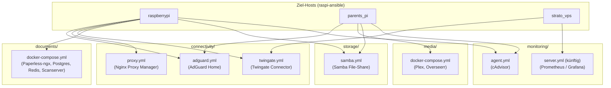

# SUP-146 Docker Konfig: die Repos docker-config und docker-conf zusammenführen und restrukturieren

Dieses Design-Dokument hält alle Entscheidungen aus unserer Grill-Session fest, um die bisherigen Repositories `docker-config` (`raspberrypi`) und `docker-conf` (`parents_pi`) im Ziel-Repository **`docker-config`** zusammenzuführen, zu vereinheitlichen und in modulare Themen-Stacks zu gliedern.

---

## 1. Ziel-Architektur & Verzeichnisstruktur

Damit jeder Host (`raspberrypi`, `parents_pi`, `strato_vps`) in `raspi-ansible` über die Liste `compose_files` passgenau nur die Dienste starten kann, die er tatsächlich benötigt, wird das Repository in **5 Themen-Ordner** mit gezielten Compose-Dateien aufgeteilt:



### Geplante Dateistruktur in `docker-config`

```text
.
├── .env.example                             # Dokumentierte Vorlage aller unterstützten Pfad- & Secret-Variablen
├── .gitignore                               # Ignoriert .env und secrets/* (keine Laufzeitdaten mehr im Repo)
├── README.md                                # Übersicht über alle Themen-Stacks, Variablen und Host-Zuordnungen
├── docs/
│   └── SUP-146 Docker Konfig: die Repos docker-config und docker-conf zusammenführen und restrukturieren.md
├── connectivity/
│   ├── adguard.yml                          # AdGuard Home (DNS & WebUI)
│   ├── proxy.yml                            # Nginx Proxy Manager (Reverse Proxy)
│   └── twingate.yml                         # Twingate Connector (Zero-Trust VPN)
├── documents/
│   └── docker-compose.yml                   # Paperless-ngx + PostgreSQL + Redis + Scanserver
├── media/
│   └── docker-compose.yml                   # Plex Media Server + Overseerr
├── storage/
│   └── samba.yml                            # Samba Server (servercontainers/samba)
└── monitoring/
    └── agent.yml                            # cAdvisor (Container-Metriken für Prometheus)
```

> [!IMPORTANT]
> **Top-Level `name:` statt veraltetem `version:` Attribut**
> Da im Ordner `connectivity/` mehrere Compose-Dateien liegen, erhält jede Compose-Datei ein explizites Top-Level-Attribut `name: <stack-name>` (z. B. `name: adguard`, `name: proxy`, `name: twingate`). Dadurch verwaltet Docker Compose jeden Baustein als eigenständiges Projekt, ohne dass sich Container oder Netzwerke im selben Unterordner gegenseitig beeinflussen. Das veraltete Attribut `version: "3.x"` entfällt vollständig.

---

## 2. Übergreifende Design-Entscheidungen

### 2.1 `.env`-Handling & Variablen-Fallbacks
1. **`.env` aus Git entfernen (`.gitignore`)**:
   * Bisher war `.env` in `docker-config` in Git eingecheckt. Wenn `raspi-ansible` Secrets per `lineinfile` in `/opt/services/.env` eingetragen hat und später `playbooks/update.yml` ein `git pull` (`force: true`) ausführte, wurde `/opt/services/.env` auf den Git-Stand zurückgesetzt und die Secrets gelöscht.
   * Künftig steht `.env` in `.gitignore`. Im Repository liegt stattdessen eine dokumentierte `.env.example`.
2. **Fallbacks (`${VAR:-default}`) direkt in den Compose-Dateien**:
   * Alle Standard-Verzeichnispfade unter `/opt/...` und `/mnt/...` werden mit Default-Werten versehen (z. B. `${ADGUARD_CONFIG:-/opt/adguard}`).
   * Nur echte Secrets (wie `${TWINGATE_ACCESS_TOKEN}` oder `${SAMBA_PASSWORD}`) verwenden Pflicht-Syntax (`${VAR:?error}`) bzw. werden über `/opt/services/.env` aus dem Ansible-Vault injiziert.
3. **Zentrale `/opt/services/.env` für alle Unterordner**:
   * Da Docker Compose standardmäßig im jeweiligen Unterordner nach einer `.env` sucht, übergibt `raspi-ansible` beim Aufruf `--env-file /opt/services/.env`.

### 2.2 Konfigurationspfade einheitlich unter `/opt/<service>`
* Alle Container-Konfigurationen liegen künftig auf beiden Pis einheitlich außerhalb des Git-Repositories unter `/opt/<service>` (z. B. `/opt/adguard`, `/opt/nginx-proxy-manager`, `/opt/plex`, `/opt/overseerr`).
* Die bisherigen relativen Ordner mit `.gitkeep` aus `docker-conf` (`./adguard`, `./plex`, `./overseerr`) entfallen komplett.
* **Wichtig für `parents_pi`**: Die produktiven Medien-Pfade (`/mnt/mediahdd/Serien`, `/mnt/mediahdd/Filme`, `/mnt/oldhdd/Bilder`) bleiben **unverändert** erhalten!

### 2.3 Gepinnte Image-Versionen
* Alle Docker-Images (inklusive `plex` und `overseerr`, die in `docker-conf` bisher auf `:latest` standen) werden auf konkrete, reproduzierbare Versionen gepinnt.
* Versions-Upgrades erfolgen kontrolliert über Git-Commits im `docker-config`-Repository und anschließendes Ausführen von `ansible-playbook playbooks/update.yml`.

---

## 3. Detailliertes Design der Themen-Stacks

### 3.1 `connectivity/adguard.yml`
Vereinheitlicht die bisherigen Abweichungen zwischen `raspberrypi` (Bridge-Netzwerk) und `parents_pi` (`network_mode: host`):
* **Netzwerk**: Sauberer Bridge-Modus auf beiden Pis.
* **Ports**:
  * `53:53/tcp` & `53:53/udp` (DNS)
  * `3000:3000/tcp` (Initiales Setup-WebUI)
  * `${ADGUARD_WEB_PORT:-8080}:80/tcp` (WebUI – Default `8080`, über `.env` pro Host steuerbar)
* **Volumes**:
  * `${ADGUARD_CONFIG:-/opt/adguard}/work:/opt/adguardhome/work`
  * `${ADGUARD_CONFIG:-/opt/adguard}/conf:/opt/adguardhome/conf`
* **Image**: `adguard/adguardhome:v0.107.77`

```yaml
name: adguard

services:
  adguard:
    image: adguard/adguardhome:v0.107.77
    container_name: adguard
    volumes:
      - "${ADGUARD_CONFIG:-/opt/adguard}/work:/opt/adguardhome/work"
      - "${ADGUARD_CONFIG:-/opt/adguard}/conf:/opt/adguardhome/conf"
    ports:
      - "53:53/tcp"
      - "53:53/udp"
      - "3000:3000/tcp"
      - "${ADGUARD_WEB_PORT:-8080}:80/tcp"
    restart: unless-stopped
```

### 3.2 `connectivity/proxy.yml`
* **Einsatzort**: `raspberrypi`
* **Image**: `jc21/nginx-proxy-manager:2.16.0` (gepinnt von `:2`)
* **Volumes**:
  * `${NPM_DATA:-/opt/nginx-proxy-manager}/data:/data`
  * `${NPM_DATA:-/opt/nginx-proxy-manager}/letsencrypt:/etc/letsencrypt`

```yaml
name: proxy

services:
  nginx-proxy-manager:
    image: jc21/nginx-proxy-manager:2.16.0
    container_name: nginx-proxy-manager
    ports:
      - "80:80"
      - "443:443"
      - "81:81"
    volumes:
      - "${NPM_DATA:-/opt/nginx-proxy-manager}/data:/data"
      - "${NPM_DATA:-/opt/nginx-proxy-manager}/letsencrypt:/etc/letsencrypt"
    restart: unless-stopped
```

### 3.3 `connectivity/twingate.yml`
* **Einsatzort**: `raspberrypi`, künftig auch `strato_vps` (und bei Bedarf `parents_pi`)
* **Image**: `twingate/connector:1.89.0`
* **Umgebungsvariablen** (aus `/opt/services/.env` via Ansible-Vault):
  * `TWINGATE_NETWORK`
  * `TWINGATE_ACCESS_TOKEN`
  * `TWINGATE_REFRESH_TOKEN`

```yaml
name: twingate

services:
  twingate-connector:
    image: twingate/connector:1.89.0
    container_name: twingate-connector
    restart: unless-stopped
    environment:
      TWINGATE_NETWORK: ${TWINGATE_NETWORK}
      TWINGATE_ACCESS_TOKEN: ${TWINGATE_ACCESS_TOKEN}
      TWINGATE_REFRESH_TOKEN: ${TWINGATE_REFRESH_TOKEN}
    sysctls:
      net.ipv4.ping_group_range: "0 2147483647"
```

### 3.4 `documents/docker-compose.yml`
* **Einsatzort**: `raspberrypi`
* **Enthaltene Services**: `paperless-redis` (`redis:7`), `paperless-db` (`postgres:15`), `paperless` (`ghcr.io/paperless-ngx/paperless-ngx:2.20.15`), `scanserver` (`ghcr.io/nicogartmann/scanner-webui:main`)
* **Volumes**: Nutzt `${PAPERLESS_DATA:-/mnt/drive/paperless}` für DB, Data, Media, Consume und Export.

```yaml
name: documents

services:
  paperless-redis:
    image: redis:7
    container_name: paperless-redis
    restart: unless-stopped

  paperless-db:
    image: postgres:15
    container_name: paperless-db
    environment:
      POSTGRES_DB: paperless
      POSTGRES_USER: paperless
      POSTGRES_PASSWORD: ${PAPERLESS_DB_PASSWORD:-paperless}
    volumes:
      - "${PAPERLESS_DATA:-/mnt/drive/paperless}/pgdata:/var/lib/postgresql/data"
    restart: unless-stopped

  paperless:
    image: ghcr.io/paperless-ngx/paperless-ngx:2.20.15
    container_name: paperless
    depends_on:
      - paperless-redis
      - paperless-db
    ports:
      - "8000:8000"
    environment:
      PAPERLESS_REDIS: redis://paperless-redis:6379
      PAPERLESS_DBHOST: paperless-db
      PAPERLESS_DBUSER: paperless
      PAPERLESS_DBPASS: ${PAPERLESS_DB_PASSWORD:-paperless}
      PAPERLESS_DBNAME: paperless
    volumes:
      - "${PAPERLESS_DATA:-/mnt/drive/paperless}/data:/usr/src/paperless/data"
      - "${PAPERLESS_DATA:-/mnt/drive/paperless}/media:/usr/src/paperless/media"
      - "${PAPERLESS_DATA:-/mnt/drive/paperless}/consume:/usr/src/paperless/consume"
      - "${PAPERLESS_DATA:-/mnt/drive/paperless}/export:/usr/src/paperless/export"
    restart: unless-stopped

  scanserver:
    image: ghcr.io/nicogartmann/scanner-webui:main
    container_name: scanserver
    pull_policy: always
    network_mode: host
    ports:
      - "5000:5000"
    volumes:
      - "${PAPERLESS_DATA:-/mnt/drive/paperless}/consume:/app/scan"
    restart: unless-stopped
```

### 3.5 `media/docker-compose.yml`
* **Einsatzort**: `parents_pi`
* **Enthaltene Services**:
  * `plex` (`lscr.io/linuxserver/plex:1.43.5`) im `network_mode: host`
  * `overseerr` (`lscr.io/linuxserver/overseerr:1.35.0`) auf Port `5055:5055`
* **Konfigurationspfade**:
  * `${PLEX_CONFIG:-/opt/plex}:/config`
  * `${OVERSEERR_CONFIG:-/opt/overseerr}:/config`
* **Medien-Pfade (unverändert zum Produktivbetrieb auf `parents_pi`)**:
  * `${PLEX_TV_PATH:-/mnt/mediahdd/Serien}:/tv`
  * `${PLEX_MOVIES_PATH:-/mnt/mediahdd/Filme}:/movies`
  * `${PLEX_PICTURES_PATH:-/mnt/oldhdd/Bilder}:/pictures`

```yaml
name: media

services:
  overseerr:
    image: lscr.io/linuxserver/overseerr:1.35.0
    container_name: overseerr
    environment:
      - PUID=1000
      - PGID=1000
      - TZ=Europe/Berlin
    volumes:
      - "${OVERSEERR_CONFIG:-/opt/overseerr}:/config"
    ports:
      - "5055:5055"
    restart: unless-stopped

  plex:
    image: lscr.io/linuxserver/plex:1.43.5
    container_name: plex
    network_mode: host
    environment:
      - PUID=1000
      - PGID=1000
      - VERSION=docker
      - TZ=Europe/Berlin
    volumes:
      - "${PLEX_CONFIG:-/opt/plex}:/config"
      - "${PLEX_TV_PATH:-/mnt/mediahdd/Serien}:/tv"
      - "${PLEX_MOVIES_PATH:-/mnt/mediahdd/Filme}:/movies"
      - "${PLEX_PICTURES_PATH:-/mnt/oldhdd/Bilder}:/pictures"
    restart: unless-stopped
```

### 3.6 `storage/samba.yml`
Ablösung des veralteten `dperson/samba`-Containers aus `docker-conf` durch die moderne, einheitliche `servercontainers/samba`-Konfiguration für beide Pis:
* **Einsatzort**: Optional/aktivierbar auf `raspberrypi` und `parents_pi`
* **Image**: `ghcr.io/servercontainers/samba:smbd-only-a3.17.3-s4.16.10-r0`
* **Steuerung über `.env`**:
  * `SAMBA_DATA`: Freizugebender Host-Pfad (auf `raspberrypi` z. B. `/mnt/drive/nas`, auf `parents_pi` `/mnt`)
  * `SAMBA_PASSWORD`: Passwort für den Samba-User `nas` aus dem jeweiligen Host-Vault

```yaml
name: samba

services:
  samba:
    image: ghcr.io/servercontainers/samba:smbd-only-a3.17.3-s4.16.10-r0
    container_name: samba
    restart: unless-stopped
    ports:
      - "139:139"
      - "445:445"
    environment:
      ACCOUNT_nas: ${SAMBA_PASSWORD}
      UID_nas: "1000"
      GROUP_nasgrp: "2000"
      GROUPS_nas: nasgrp
      SAMBA_VOLUME_CONFIG_nas: "[nas]; path = /shares/nas; valid users = nas; guest ok = no; read only = no"
    volumes:
      - "${SAMBA_DATA:-/mnt/drive/nas}:/shares/nas"
```

### 3.7 `monitoring/agent.yml`
* **Einsatzort**: `raspberrypi`, `parents_pi`
* **Image**: `gcr.io/cadvisor/cadvisor:v0.49.1`
* **Port**: `8081:8080` (da `8080` von AdGuard genutzt wird)

```yaml
name: monitoring-agent

services:
  cadvisor:
    image: gcr.io/cadvisor/cadvisor:v0.49.1
    container_name: cadvisor
    restart: unless-stopped
    ports:
      - "8081:8080"
    volumes:
      - "/:/rootfs:ro"
      - "/var/run:/var/run:ro"
      - "/sys:/sys:ro"
      - "/var/lib/docker/:/var/lib/docker:ro"
      - "/dev/disk/:/dev/disk:ro"
    devices:
      - "/dev/kmsg"
```

---

## 4. Umsetzungsplan (Schritte im Branch `feature/SUP-146`)

1. **Schritt 1 – Zusammenführung (Import des IST-Stands aus `docker-conf`)**:
   * Übernahme der `docker-conf`-Services (`plex`, `overseerr`, `samba`, `adguard`) in das `docker-config`-Repository als nachvollziehbarer Zwischenschritt, ohne die alte Git-Commit-Historie von `docker-conf` zu mergen.
2. **Schritt 2 – Restrukturierung & Vereinheitlichung in die 5 Themen-Ordner**:
   * Anlegen von `connectivity/{adguard,proxy,twingate}.yml`, `documents/docker-compose.yml`, `media/docker-compose.yml`, `storage/samba.yml` und `monitoring/agent.yml`.
   * Entfernen der monolithischen Root-`docker-compose.yml`.
   * Entfernen von `.env` aus dem Git-Index (`git rm --cached .env`), Aufnahme von `.env` in `.gitignore` und Erstellen einer dokumentierten `.env.example`.
   * Erstellen einer übersichtlichen `README.md` für `docker-config`.
3. **Schritt 3 – Ansible-Abgleich & Migration auf den Pis**:
   * Alle notwendigen Anpassungen im `raspi-ansible`-Projekt sowie die Schritt-für-Schritt-Migrationscheckliste für `parents_pi` (Umzug der App-Configs von `/home/pi/docker-conf/...` nach `/opt/...`) sind im Begleitdokument [`raspi-ansible/docs/SUP-146.md`](../../raspi-ansible/docs/SUP-146.md) festgehalten.
4. **Schritt 4 – Abschluss**:
   * Nach erfolgreichem Rollout auf `raspberrypi` und `parents_pi` wird das alte Repository `docker-conf` auf GitHub archiviert.
