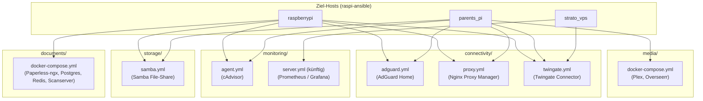

# SUP-146 Docker Konfig: die Repos docker-config und docker-conf zusammenführen und restrukturieren

Dieses Design-Dokument hält alle Entscheidungen aus unserer Grill-Session fest, um die bisherigen Repositories `docker-config` (`raspberrypi`) und `docker-conf` (`parents_pi`) im Ziel-Repository **`docker-config`** zusammenzuführen, zu vereinheitlichen und in modulare Themen-Stacks zu gliedern.

---

## 1. Ziel-Architektur & Verzeichnisstruktur

Damit jeder Host (`raspberrypi`, `parents_pi`, `strato_vps`) in `raspi-ansible` über die Liste `compose_files` passgenau nur die Dienste starten kann, die er tatsächlich benötigt, wird das Repository in **5 Themen-Ordner** mit gezielten Compose-Dateien aufgeteilt:



### Geplante Dateistruktur in `docker-config`

```text
.
├── .env.example                             # Dokumentierte Vorlage aller unterstützten Pfad- & Secret-Variablen
├── .gitignore                               # Ignoriert .env und secrets/* (keine Laufzeitdaten mehr im Repo)
├── README.md                                # Übersicht über alle Themen-Stacks, Variablen und Host-Zuordnungen
├── docs/
│   └── SUP-146.md
├── connectivity/
│   ├── adguard.yml                          # AdGuard Home (DNS & WebUI) – für raspberrypi & parents_pi
│   ├── proxy.yml                            # Nginx Proxy Manager (Reverse Proxy) – für raspberrypi & parents_pi
│   └── twingate.yml                         # Twingate Connector (Zero-Trust VPN) – zwingend auf ALLEN Hosts
├── documents/
│   └── docker-compose.yml                   # Paperless-ngx + PostgreSQL + Redis + Scanserver – für raspberrypi
├── media/
│   └── docker-compose.yml                   # Plex Media Server + Overseerr – für parents_pi
├── storage/
│   └── samba.yml                            # Samba Server (servercontainers/samba) – für raspberrypi & parents_pi
└── monitoring/
    └── agent.yml                            # cAdvisor (Container-Metriken) – für raspberrypi & parents_pi
```

> [!IMPORTANT]
> **Top-Level `name:` statt veraltetem `version:` Attribut**
> Da im Ordner `connectivity/` mehrere Compose-Dateien liegen, erhält jede Compose-Datei ein explizites Top-Level-Attribut `name: <stack-name>` (z. B. `name: adguard`, `name: proxy`, `name: twingate`). Dadurch verwaltet Docker Compose jeden Baustein als eigenständiges Projekt, ohne dass sich Container oder Netzwerke im selben Unterordner gegenseitig beeinflussen. Das veraltete Attribut `version: "3.x"` entfällt vollständig.

---

## 2. Übergreifende Design-Entscheidungen

### 2.1 `.env`-Handling & Variablen-Fallbacks
1. **`.env` aus Git entfernen (`.gitignore`)**:
   * Bisher war `.env` in `docker-config` in Git eingecheckt. Wenn `raspi-ansible` Secrets per `lineinfile` in `/opt/services/.env` eingetragen hat und später `playbooks/update.yml` ein `git pull` (`force: true`) ausführte, wurde `/opt/services/.env` auf den Git-Stand zurückgesetzt und die Secrets gelöscht.
   * Künftig steht `.env` in `.gitignore`. Im Repository liegt stattdessen eine dokumentierte `.env.example`.
2. **Fallbacks (`${VAR:-default}`) direkt in den Compose-Dateien**:
   * Alle Standard-Verzeichnispfade unter `/opt/...` und `/mnt/...` werden mit Default-Werten versehen (z. B. `${ADGUARD_CONFIG:-/opt/adguard}`).
   * Nur echte Secrets (wie `${TWINGATE_ACCESS_TOKEN}` oder `${SAMBA_PASSWORD}`) werden ohne Default aus `/opt/services/.env` (befüllt über den jeweiligen Host-Vault in `raspi-ansible`) injiziert.
3. **Zentrale `/opt/services/.env` für alle Unterordner**:
   * Da Docker Compose standardmäßig im jeweiligen Unterordner nach einer `.env` sucht, übergibt `raspi-ansible` beim Aufruf `--env-file /opt/services/.env`.

### 2.2 Schutz produktiver Bestandsdaten & Konfigurationspfade unter `/opt/<service>`
* **Oberste Priorität – Kein Datenverlust bei Bestandsdaten**:
  * Auf **`raspberrypi`** ist Paperless-ngx unter `/mnt/drive/paperless` (`pgdata`, `data`, `media`, `consume`, `export`) bereits produktiv in Benutzung. Dieser Pfad (`PAPERLESS_DATA=/mnt/drive/paperless`) sowie das interne DB-Passwort (`paperless`) bleiben **100 % unverändert**.
  * Auf **`parents_pi`** ist Plex mit den Medien-Pfaden (`/mnt/mediahdd/Serien`, `/mnt/mediahdd/Filme`, `/mnt/oldhdd/Bilder`) produktiv in Benutzung. Auch diese Pfade bleiben **100 % unverändert**.
* **Einheitliche App-Configs unter `/opt/<service>`**:
  * Alle Container-Konfigurationen liegen künftig auf beiden Pis einheitlich außerhalb des Git-Repositories unter `/opt/<service>` (`/opt/adguard`, `/opt/nginx-proxy-manager`, `/opt/plex`, `/opt/overseerr`).
  * Die bisherigen relativen Ordner mit `.gitkeep` aus `docker-conf` (`./adguard`, `./plex`, `./overseerr`) entfallen komplett.

### 2.3 Gepinnte, stabile Release-Versionen
* Alle Docker-Images werden ausschließlich auf **offizielle, stabile Release-Versionen** gepinnt (keine `:latest`-Tags für Apps und keine Release-Candidates/Pre-Releases).
* Versions-Upgrades erfolgen kontrolliert über Git-Commits im `docker-config`-Repository und anschließendes Ausführen von `ansible-playbook playbooks/update.yml`.

---

## 3. Detailliertes Design der Themen-Stacks

### 3.1 `connectivity/adguard.yml`
Vereinheitlicht die bisherigen Abweichungen zwischen `raspberrypi` (Bridge-Netzwerk) und `parents_pi` (`network_mode: host`):
* **Einsatzort**: `raspberrypi`, `parents_pi`
* **Netzwerk**: Sauberer Bridge-Modus auf beiden Pis (da auf beiden Pis auch Nginx Proxy Manager auf Port 80/443 laufen kann).
* **Ports**:
  * `53:53/tcp` & `53:53/udp` (DNS)
  * `3000:3000/tcp` (Initiales Setup-WebUI)
  * `${ADGUARD_WEB_PORT:-8080}:80/tcp` (WebUI – Default `8080`, kollisionsfrei mit Nginx Proxy Manager)
* **Volumes**:
  * `${ADGUARD_CONFIG:-/opt/adguard}/work:/opt/adguardhome/work`
  * `${ADGUARD_CONFIG:-/opt/adguard}/conf:/opt/adguardhome/conf`
* **Image**: `adguard/adguardhome:v0.107.77`

```yaml
name: adguard

services:
  adguard:
    image: adguard/adguardhome:v0.107.77
    container_name: adguard
    volumes:
      - "${ADGUARD_CONFIG:-/opt/adguard}/work:/opt/adguardhome/work"
      - "${ADGUARD_CONFIG:-/opt/adguard}/conf:/opt/adguardhome/conf"
    ports:
      - "53:53/tcp"
      - "53:53/udp"
      - "3000:3000/tcp"
      - "${ADGUARD_WEB_PORT:-8080}:80/tcp"
    restart: unless-stopped
```

### 3.2 `connectivity/proxy.yml`
* **Einsatzort**: `raspberrypi`, `parents_pi`
* **Image**: `jc21/nginx-proxy-manager:2.16.0` (gepinnt auf stabiles Release statt `:2`)
* **Volumes**:
  * `${NPM_DATA:-/opt/nginx-proxy-manager}/data:/data`
  * `${NPM_DATA:-/opt/nginx-proxy-manager}/letsencrypt:/etc/letsencrypt`

```yaml
name: proxy

services:
  nginx-proxy-manager:
    image: jc21/nginx-proxy-manager:2.16.0
    container_name: nginx-proxy-manager
    ports:
      - "80:80"
      - "443:443"
      - "81:81"
    volumes:
      - "${NPM_DATA:-/opt/nginx-proxy-manager}/data:/data"
      - "${NPM_DATA:-/opt/nginx-proxy-manager}/letsencrypt:/etc/letsencrypt"
    restart: unless-stopped
```

### 3.3 `connectivity/twingate.yml`
* **Einsatzort**: **Zwingend auf allen Systemen** (`raspberrypi`, `parents_pi`, `strato_vps`), um den Remote-Zugriff auf jedes Gerät im Twingate-Netzwerk sicherzustellen.
* **Image**: `twingate/connector:1.95.0` (aktuelles stabiles Release, das bereits auf `parents_pi` im Einsatz ist; Hinweis: auf Docker Hub lautet der offizielle Tag `1.95.0` ohne führendes `v`).
* **Umgebungsvariablen** (aus `/opt/services/.env`, gespeist aus dem jeweiligen Host-spezifischen Ansible-Vault `vaults/<hostname>.yml`, da jeder Connector eigene Access-/Refresh-Tokens besitzt):
  * `TWINGATE_NETWORK`
  * `TWINGATE_ACCESS_TOKEN`
  * `TWINGATE_REFRESH_TOKEN`

```yaml
name: twingate

services:
  twingate-connector:
    image: twingate/connector:1.95.0
    container_name: twingate-connector
    restart: unless-stopped
    environment:
      TWINGATE_NETWORK: ${TWINGATE_NETWORK}
      TWINGATE_ACCESS_TOKEN: ${TWINGATE_ACCESS_TOKEN}
      TWINGATE_REFRESH_TOKEN: ${TWINGATE_REFRESH_TOKEN}
    sysctls:
      net.ipv4.ping_group_range: "0 2147483647"
```

### 3.4 `documents/docker-compose.yml`
* **Einsatzort**: `raspberrypi`
* **Enthaltene Services**: `paperless-redis` (`redis:7`), `paperless-db` (`postgres:15`), `paperless` (`ghcr.io/paperless-ngx/paperless-ngx:2.20.15`), `scanserver` (`ghcr.io/nicogartmann/scanner-webui:main`)
* **Volumes**: Nutzt `${PAPERLESS_DATA:-/mnt/drive/paperless}` für `pgdata`, `data`, `media`, `consume` und `export`.

> [!CAUTION]
> **Produktivdaten-Schutz für Paperless-ngx (`/mnt/drive/paperless`)**
> Paperless-ngx ist auf `raspberrypi` aktiv in Benutzung. Alle Host-Mount-Pfade unter `/mnt/drive/paperless/{pgdata,data,media,consume,export}` sowie die Datenbank-Zugangsdaten (`paperless`) bleiben exakt identisch zum bisherigen Stand. Da sämtliche Verzeichnisse als Host-Bind-Mounts auf der externen Festplatte `/mnt/drive` liegen, bleiben beim Stoppen des alten Containers und Starten des neuen `documents`-Stacks alle Dokumente, Suchindizes und Datenbank-Inhalte vollständig erhalten.

```yaml
name: documents

services:
  paperless-redis:
    image: redis:7
    container_name: paperless-redis
    restart: unless-stopped

  paperless-db:
    image: postgres:15
    container_name: paperless-db
    environment:
      POSTGRES_DB: paperless
      POSTGRES_USER: paperless
      POSTGRES_PASSWORD: ${PAPERLESS_DB_PASSWORD:-paperless}
    volumes:
      - "${PAPERLESS_DATA:-/mnt/drive/paperless}/pgdata:/var/lib/postgresql/data"
    restart: unless-stopped

  paperless:
    image: ghcr.io/paperless-ngx/paperless-ngx:2.20.15
    container_name: paperless
    depends_on:
      - paperless-redis
      - paperless-db
    ports:
      - "8000:8000"
    environment:
      PAPERLESS_REDIS: redis://paperless-redis:6379
      PAPERLESS_DBHOST: paperless-db
      PAPERLESS_DBUSER: paperless
      PAPERLESS_DBPASS: ${PAPERLESS_DB_PASSWORD:-paperless}
      PAPERLESS_DBNAME: paperless
      PAPERLESS_TIME_ZONE: Europe/Berlin
      PAPERLESS_OCR_LANGUAGE: deu+eng
    volumes:
      - "${PAPERLESS_DATA:-/mnt/drive/paperless}/data:/usr/src/paperless/data"
      - "${PAPERLESS_DATA:-/mnt/drive/paperless}/media:/usr/src/paperless/media"
      - "${PAPERLESS_DATA:-/mnt/drive/paperless}/consume:/usr/src/paperless/consume"
      - "${PAPERLESS_DATA:-/mnt/drive/paperless}/export:/usr/src/paperless/export"
    restart: unless-stopped

  scanserver:
    image: ghcr.io/nicogartmann/scanner-webui:main
    container_name: scanserver
    pull_policy: always
    network_mode: host # Lauscht direkt auf Host-Port 5000
    volumes:
      - "${PAPERLESS_DATA:-/mnt/drive/paperless}/consume:/app/scan"
    restart: unless-stopped
```

### 3.5 `media/docker-compose.yml`
* **Einsatzort**: `parents_pi`
* **Enthaltene Services**:
  * `plex` (`lscr.io/linuxserver/plex:1.43.5`) im `network_mode: host`
  * `overseerr` (`lscr.io/linuxserver/overseerr:1.35.0`) auf Port `5055:5055`
* **Konfigurationspfade**:
  * `${PLEX_CONFIG:-/opt/plex}:/config`
  * `${OVERSEERR_CONFIG:-/opt/overseerr}:/config`
* **Medien-Pfade (unverändert zum Produktivbetrieb auf `parents_pi`)**:
  * `${PLEX_TV_PATH:-/mnt/mediahdd/Serien}:/tv`
  * `${PLEX_MOVIES_PATH:-/mnt/mediahdd/Filme}:/movies`
  * `${PLEX_PICTURES_PATH:-/mnt/oldhdd/Bilder}:/pictures`

```yaml
name: media

services:
  overseerr:
    image: lscr.io/linuxserver/overseerr:1.35.0
    container_name: overseerr
    environment:
      - PUID=1000
      - PGID=1000
      - TZ=Europe/Berlin
    volumes:
      - "${OVERSEERR_CONFIG:-/opt/overseerr}:/config"
    ports:
      - "5055:5055"
    restart: unless-stopped

  plex:
    image: lscr.io/linuxserver/plex:1.43.5
    container_name: plex
    network_mode: host
    environment:
      - PUID=1000
      - PGID=1000
      - VERSION=docker
      - TZ=Europe/Berlin
    volumes:
      - "${PLEX_CONFIG:-/opt/plex}:/config"
      - "${PLEX_TV_PATH:-/mnt/mediahdd/Serien}:/tv"
      - "${PLEX_MOVIES_PATH:-/mnt/mediahdd/Filme}:/movies"
      - "${PLEX_PICTURES_PATH:-/mnt/oldhdd/Bilder}:/pictures"
    restart: unless-stopped
```

### 3.6 `storage/samba.yml`
Ablösung des veralteten `dperson/samba`-Containers aus `docker-conf` durch die moderne, einheitliche `servercontainers/samba`-Konfiguration für beide Pis:
* **Einsatzort**: `raspberrypi`, `parents_pi`
* **Image**: `ghcr.io/servercontainers/samba:smbd-only-a3.24.1-s4.23.8-r0`

> [!NOTE]
> **Hintergrund zum Tag-Schema von `servercontainers/samba`**
> Das Suffix `-r0` ist bei diesem Image **kein** Release-Candidate (`-rc`), sondern das offizielle stabile Paket-Schema von Alpine Linux:
> * `a3.24.1` = Alpine Linux `3.24.1` (Stable)
> * `s4.23.8` = Samba `4.23.8` (Stable)
> * `r0` = Alpine APK Package Revision `0` (regulärer stabiler Paket-Build)

* **Steuerung über `.env`**:
  * `SAMBA_DATA`: Freizugebender Host-Pfad (auf `raspberrypi` `/mnt/drive/nas`, auf `parents_pi` `/mnt`)
  * `SAMBA_PASSWORD`: Passwort für den Samba-User `nas` aus dem jeweiligen Host-Vault (`vaults/<hostname>.yml`)

```yaml
name: samba

services:
  samba:
    image: ghcr.io/servercontainers/samba:smbd-only-a3.24.1-s4.23.8-r0
    container_name: samba
    restart: unless-stopped
    ports:
      - "139:139"
      - "445:445"
    environment:
      ACCOUNT_nas: ${SAMBA_PASSWORD}
      UID_nas: "1000"
      SAMBA_VOLUME_CONFIG_nas: "[nas]; path = /shares/nas; valid users = nas; guest ok = no; read only = no; browseable = yes; force user = nas; force group = nas"
    volumes:
      - "${SAMBA_DATA:-/mnt/drive/nas}:/shares/nas"
```

### 3.7 `monitoring/agent.yml`
* **Einsatzort**: `raspberrypi`, `parents_pi`
* **Image**: `gcr.io/cadvisor/cadvisor:v0.49.1`
* **Port**: `8081:8080` (da `8080` von AdGuard genutzt wird)

```yaml
name: monitoring-agent

services:
  cadvisor:
    image: gcr.io/cadvisor/cadvisor:v0.49.1
    container_name: cadvisor
    restart: unless-stopped
    ports:
      - "8081:8080"
    volumes:
      - "/:/rootfs:ro"
      - "/var/run:/var/run:ro"
      - "/sys:/sys:ro"
      - "/var/lib/docker/:/var/lib/docker:ro"
      - "/dev/disk/:/dev/disk:ro"
    devices:
      - "/dev/kmsg"
```

---

## 4. Umsetzungsplan & Geplante Zwischen-Commits (Branch `feature/SUP-146`)

Bei der Umsetzung arbeiten wir mit kleinteiligen, logisch getrennten Zwischen-Commits nach Conventional Commits:

1. **Commit 1 – Design-Dokument finalisieren**:
   * `docs(SUP-146): update design document with review feedback`
2. **Commit 2 – IST-Stand aus `docker-conf` übernehmen (Zusammenführung)**:
   * `feat(SUP-146): import services from docker-conf repository`
   * Übernimmt zunächst die bisherigen Services aus `docker-conf` (`plex`, `overseerr`, `samba`), damit die Zusammenführung in der Git-Historie von `docker-config` sauber nachvollziehbar ist.
3. **Commit 3 – Aufteilung in die 5 Themen-Ordner & Vereinheitlichung**:
   * `refactor(SUP-146): split monolithic compose into thematic stacks and pin versions`
   * Erstellt `connectivity/{adguard,proxy,twingate}.yml`, `documents/docker-compose.yml`, `media/docker-compose.yml`, `storage/samba.yml` und `monitoring/agent.yml` und entfernt die monolithische Root-`docker-compose.yml`.
4. **Commit 4 – `.env`-Bereinigung & `.env.example`**:
   * `chore(SUP-146): untrack .env, update .gitignore and add .env.example`
   * Entfernt `.env` aus dem Git-Tracking (`git rm --cached .env`), ergänzt `.env` in `.gitignore` und legt `.env.example` an.
5. **Commit 5 – Dokumentation (`README.md`)**:
   * `docs(SUP-146): add README with stack overview and environment variables`
6. **Anschließend – Ansible-Abgleich & Migration**:
   * Die gekoppelten Anpassungen im `raspi-ansible`-Repository sowie die Schritt-für-Schritt-Migrationsanleitung für `raspberrypi` und `parents_pi` sind unter [`https://github.com/NicoGartmann/raspi-ansible/blob/main/docs/SUP-146.md`](https://github.com/NicoGartmann/raspi-ansible/blob/main/docs/SUP-146.md) dokumentiert.
   * Nach erfolgreichem Rollout wird das alte Repository `docker-conf` auf GitHub archiviert.
